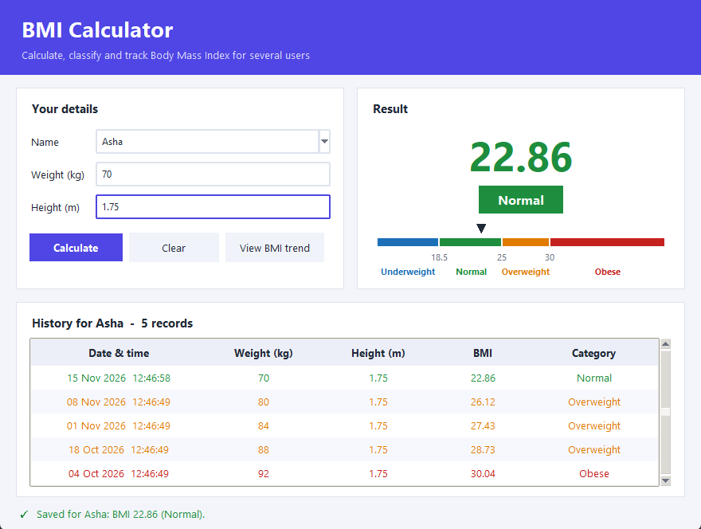
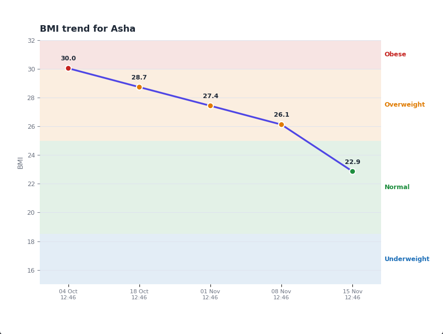

# BMI Calculator - Python Task 2 (Advanced tier)

A desktop **BMI Calculator** built with **tkinter**. It calculates Body Mass Index, classifies it into the standard health categories with colour-coded feedback, stores every result in an **SQLite** database for **several named users**, and draws a **matplotlib trend chart** of a user's BMI over time.

Built for the Oasis Infobyte internship (OIBSIP), Python Programming track, Task 2.

**Demo video:** [demo/Python-Task2-BMICalculator-demo.mp4](demo/Python-Task2-BMICalculator-demo.mp4) (45 seconds; GitHub plays it in the browser)

| Result and history | Trend chart |
|---|---|
|  |  |

## Features (checklist from the task card)

| Task requirement | Where it is |
|---|---|
| GUI window with tkinter - no command line | `app.py` (`BMIApp`) |
| Input fields with labels for weight and height, and a **Calculate** button | `app.py` |
| `BMI = weight / height^2`, shown rounded to 2 decimals with the category | `bmi_core.calculate_bmi`, `classify_bmi` |
| Categories: Underweight (< 18.5), Normal (18.5-24.9), Overweight (25-29.9), Obese (>= 30) | `bmi_core.classify_bmi` |
| Colour-coded result (blue / green / orange / red) plus a gauge that marks where the BMI falls | `app.CATEGORY_COLOURS`, `app.BMIGauge` |
| Input validation: non-numeric, empty, zero and negative values are rejected with a helpful message | `bmi_core.parse_weight`, `parse_height` |
| **Multi-user support** - save BMI records for different named users | `bmi_core.BMIDatabase` (names matched case-insensitively) |
| History stored in an **SQLite** database | `bmi_core.BMIDatabase` -> `bmi_records.db` |
| **Graph view** - line chart of a user's BMI trend over time using matplotlib | `app.build_trend_figure` ("View BMI trend") |
| Error handling for database read/write failures | `DatabaseError`, shown in the window's status line |

Extra care taken: a height typed in centimetres (e.g. `175`) is rejected with a hint to use metres, a weight/height outside human limits is caught, and nothing is saved when the input is invalid.

## How to run

```bash
pip install -r requirements.txt
python app.py              # history is kept in bmi_records.db next to app.py
python app.py --db my.db   # or choose another database file
```

1. Type or pick a **name** (their saved history appears).
2. Enter **weight (kg)** and **height (m)**, press **Calculate** - the record is saved.
3. Press **View BMI trend** to see the chart for that user.

## Tests

```bash
python -m pytest -q
```

47 tests: BMI maths and category boundaries, validation of bad input, multi-user SQLite storage, database failure handling, and smoke tests that drive the real tkinter window (colours, errors shown in the window, per-user history, trend window).

## Files

```
app.py                 tkinter GUI + gauge + trend chart
theme.py               shared colours, fonts and ttk styles for the modern look
bmi_core.py            calculation, validation and the SQLite repository (no GUI code)
test_bmi.py            unit tests
test_gui_smoke.py      GUI tests
screenshots/           pictures used in this README
demo/                  demo video of the app
```

## Privacy

Records are stored only in the local `bmi_records.db` file (it is git-ignored). Nothing is sent over the network.
