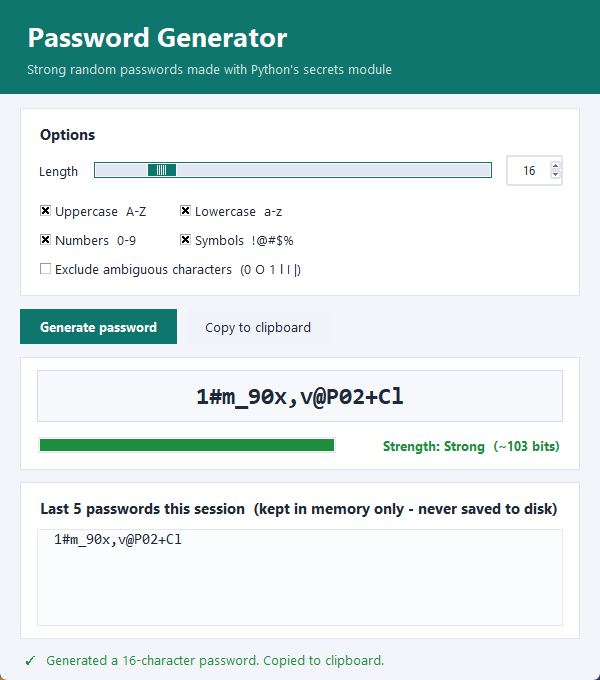
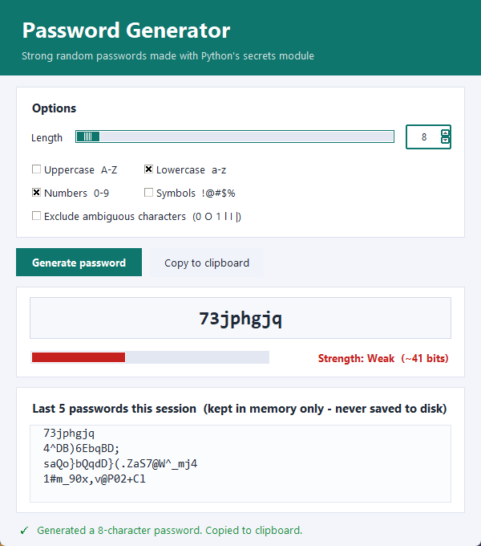

# Random Password Generator - Python Task 3 (Advanced tier)

A **tkinter** password generator that creates strong random passwords with Python's **`secrets`** module (cryptographically secure - never `random`), shows a **strength indicator**, **copies the result to the clipboard automatically**, and keeps the **last 5 passwords of the session** in memory only.

Built for the Oasis Infobyte internship (OIBSIP), Python Programming track, Task 3.

| Strong password | Weak password (short, few types) |
|---|---|
|  |  |

## Features (checklist from the task card)

| Task requirement | Where it is |
|---|---|
| GUI window with a **slider** and **spinbox** for length (kept in sync) and **checkboxes** for character types | `app.py` |
| Length validated: minimum 8 characters enforced (maximum 128) | `password_core.parse_length` |
| Character types: uppercase, lowercase, numbers, symbols - **at least 2** must be selected | `password_core.build_pools` |
| Uses the **`secrets`** module (not `random`) | `password_core.generate_password` |
| **Security rule:** the password is guaranteed to contain at least one character from every selected type | `generate_password` (one guaranteed character per type, rest random, then shuffled with `secrets.SystemRandom`) |
| **Strength indicator** - coloured bar plus a Weak / Medium / Strong label from length and character diversity | `password_core.password_strength` |
| **Copy to Clipboard** button with `pyperclip`; the password is also copied automatically on generation | `app.copy_to_clipboard` |
| Option to **exclude ambiguous characters** (`0 O 1 l I \|`) via a checkbox | `Options.exclude_ambiguous` |
| **Generation history:** last 5 passwords of the session, never written to disk | `password_core.PasswordHistory` |
| Input validation: invalid length / no or too few character types give a clear message in the window | `PasswordError`, status line in `app.py` |
| Generate another password without restarting | press **Generate password** again |

The Beginner-tier command-line version is also included (`password_cli.py`) and uses the same secure generator.

### How strength is rated

Strength is estimated as `length x log2(size of the character pool used)`:

| Estimated entropy | Label |
|---|---|
| under 50 bits | Weak |
| 50 - 79 bits | Medium |
| 80 bits or more | Strong |

For example `abc12345` is about 41 bits (Weak), a 10-character letters-and-numbers password is about 60 bits (Medium) and a 16-character password with all four types is about 103 bits (Strong). This is a rough guide, not a guarantee.

## How to run

```bash
pip install -r requirements.txt
python app.py            # GUI
python password_cli.py   # command-line version
```

## Tests

```bash
python -m pytest -q
```

42 tests: length validation, every combination of two or more character types (300 generations each, so the "at least one of each selected type" rule is checked statistically), ambiguous-character exclusion, uniqueness of generated passwords, strength labels, session history, the command-line flow, and smoke tests that drive the real window (clipboard is faked in tests).

## Files

```
app.py               tkinter GUI (slider + spinbox, checkboxes, strength bar, history, clipboard)
theme.py             shared colours, fonts and ttk styles for the modern look
password_core.py     generation, validation, strength and history (no GUI code)
password_cli.py      command-line (Beginner tier) version
test_password.py     unit tests + CLI test
test_gui_smoke.py    GUI tests
screenshots/         pictures used in this README
```

## Privacy and security notes

- Passwords exist only in memory. The history list is **not saved to a file** (a test checks the core module never opens files or databases).
- Generated passwords are copied to the system clipboard so you can paste them; clipboard managers on your computer may keep a copy.
- Nothing is sent over the network.
