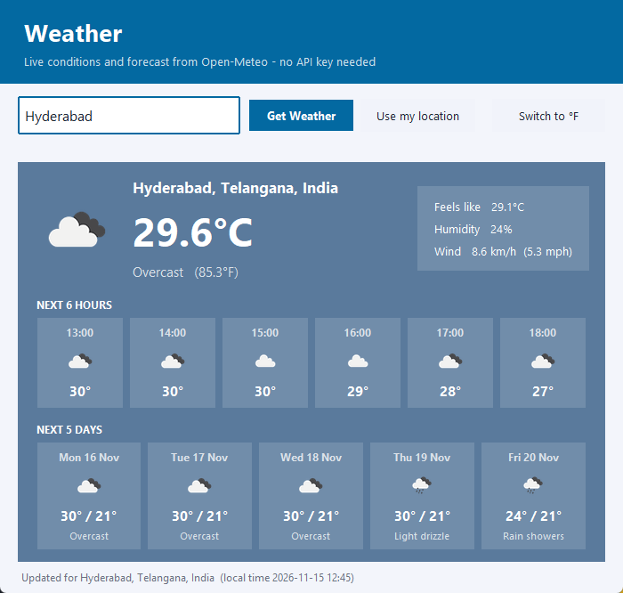
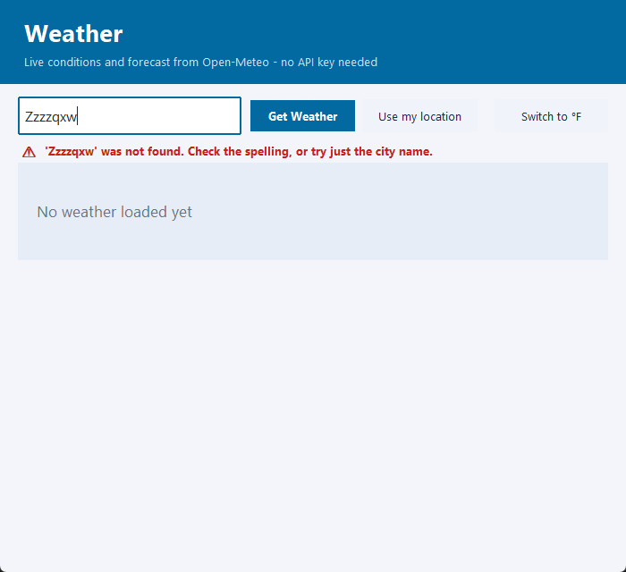
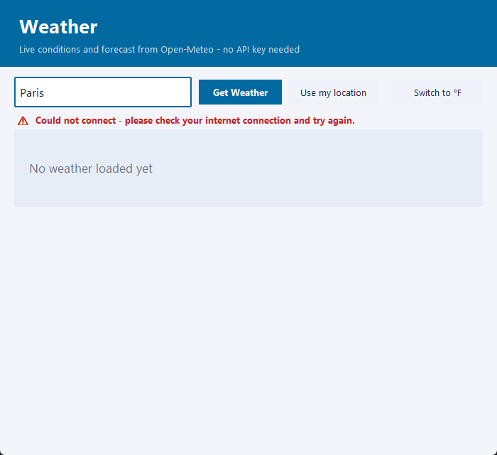

# Weather App - Python Task 4 (Advanced tier)

A **tkinter** weather app: type a city, get the **current weather**, the **next 6 hours**, the **next 5 days**, with **weather icons** and a **Celsius / Fahrenheit switch**. All errors are shown inside the window.

Built for the Oasis Infobyte internship (OIBSIP), Python Programming track, Task 4.

**Demo video:** [demo/Python-Task4-WeatherApp-demo.mp4](demo/Python-Task4-WeatherApp-demo.mp4) (1 min 8 s; GitHub plays it in the browser)

| Hyderabad (C) | Same data in Fahrenheit |
|---|---|
|  |  |

## Data sources (and why no API key)

- **Weather and geocoding:** [Open-Meteo](https://open-meteo.com/) - a free weather API that needs **no API key**. The task allows "OpenWeatherMap (or equivalent free API)", so this keeps the project runnable by anyone straight after `pip install`.
- **Icons:** the public OpenWeatherMap icon images (`https://openweathermap.org/img/wn/<code>@2x.png`). Open-Meteo's WMO weather codes are mapped to the matching OpenWeatherMap icon codes (see `weather_core.WMO`).
- **Bonus - automatic location:** the **Use my location** button asks [ipinfo.io](https://ipinfo.io/) (free tier) where your IP address is. It only runs when you press the button, and it sends your IP address to ipinfo.io.

## Features (checklist from the task card)

| Task requirement | Where it is |
|---|---|
| GUI window with a city input field, a **Get Weather** button and a results panel | `app.py` |
| Real API call with JSON parsing | `weather_core.WeatherClient` |
| Show temperature in **both C and F**, humidity %, condition description, wind speed | current-weather card (main value in the selected unit, other unit in brackets, wind in km/h and mph) |
| **Weather icons** for the current condition (OpenWeatherMap icon URLs) | `weather_core.icon_code`, `download_icon` |
| **Hourly forecast:** next 6 hours | `parse_forecast` -> "Next 6 hours" panel |
| **Daily forecast:** next 5 days | `parse_forecast` -> "Next 5 days" panel |
| **Unit toggle** Celsius / Fahrenheit | **Switch to F / C** button - converts every panel instantly, without a new request |
| (Bonus) automatic location via IP | **Use my location** button |
| Error messages shown **inside the GUI** (not in the terminal) | red message line under the search bar |
| Handle errors: city not found, network problems/timeouts, bad responses, empty input | `CityNotFoundError`, `NetworkError`, `ApiError`, `InvalidInputError` |

The network calls run in a background thread, so the window never freezes while loading, and the buttons are disabled while a request is running.

| City not found | No connection |
|---|---|
|  |  |

## How to run

```bash
pip install -r requirements.txt
python app.py
```

Type a city name (for example `Hyderabad`) and press **Get Weather** (or Enter). A plain name uses the best match. To be exact, add a country or state after a comma, for example `Paris, Texas` or `Hyderabad, India` (country names and two-letter codes both work). Postal codes are not supported.

## Tests

```bash
python -m pytest -q
```

45 tests, all **offline** (the HTTP calls are replaced by a fake): input validation, geocoding success and "not found", timeouts / no connection / HTTP 4xx-5xx / invalid JSON, parsing of the forecast (including the hourly list rolling over midnight and incomplete replies), weather-code and icon mapping, temperature conversion, and smoke tests that drive the real window with a fake client (C/F switch, error messages, icon fallback, unexpected exceptions).

## Files

```
app.py               tkinter GUI (background-thread lookups, icons, C/F switch; the panel colour follows the weather)
theme.py             shared colours, fonts and ttk styles for the modern look
weather_core.py      API client, data classes, parsing, conversions (no GUI code)
test_weather.py      offline unit tests
test_gui_smoke.py    GUI tests with a fake client
screenshots/         pictures used in this README
demo/                demo video of the app
```
