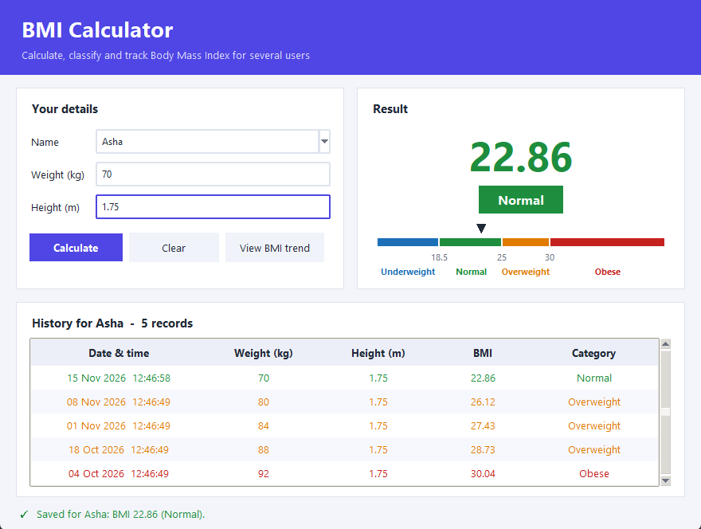
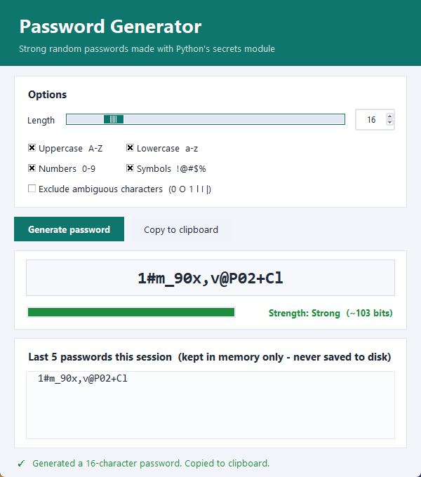
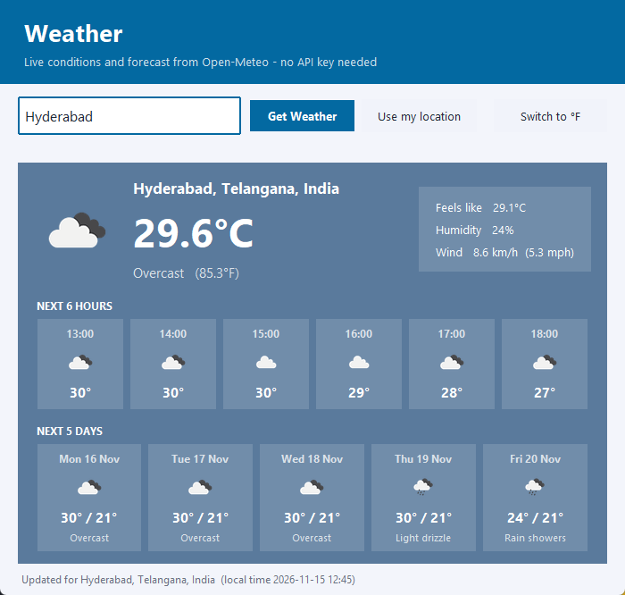

# OIBSIP - Oasis Infobyte Internship Projects

**Intern:** Sannidhi Ranga Sudeeksha  
**Track:** Python Programming  
**Batch:** November - December 2026

This repository holds my submissions for the Oasis Infobyte internship (AICTE OIB-SIP programme). The Python Programming track asks for at least 3 of 5 tasks; I built three of them at the **Advanced tier**, each as a desktop GUI app with its own README, tests and screenshots.

| Task | Project | What it does | Demo video | Tests |
|---|---|---|---|---|
| 2 | [BMI Calculator](Python-Task2-BMICalculator) | tkinter GUI, colour-coded BMI result, multi-user SQLite history, matplotlib trend chart | [Watch](Python-Task2-BMICalculator/demo/Python-Task2-BMICalculator-demo.mp4) | 47 |
| 3 | [Random Password Generator](Python-Task3-PasswordGenerator) | tkinter GUI, `secrets`-based generation, strength bar, clipboard copy, ambiguous-character option, last-5 history | [Watch](Python-Task3-PasswordGenerator/demo/Python-Task3-PasswordGenerator-demo.mp4) | 42 |
| 4 | [Weather App](Python-Task4-WeatherApp) | tkinter GUI, live current / 6-hour / 5-day forecast with icons, C/F switch, errors shown in the window | [Watch](Python-Task4-WeatherApp/demo/Python-Task4-WeatherApp-demo.mp4) | 45 |

## About each project

### Task 2 - BMI Calculator



**What it is.** A desktop app that works out your Body Mass Index and remembers it, so you can watch your progress over time.

**How you use it.** Type a name, enter weight in kilograms and height in metres, and press **Calculate**. The app shows the BMI (weight divided by height squared) with its category - Underweight, Normal, Overweight or Obese. The result is colour-coded and a gauge marks where the number falls. Every result is saved under that name, so several people can share the same app and each keeps their own history. **View BMI trend** opens a line chart of one person's BMI over time.

**How it works.**
- `bmi_core.py` holds the maths, the category rules, the input checks and the database code. It has no window code, so it can be tested on its own.
- `app.py` builds the window with tkinter and draws the gauge and the matplotlib chart.
- Results are stored in a local SQLite file; names are matched ignoring upper/lower case.
- Bad input (empty, text, zero, negative, a height typed in centimetres) is rejected with a clear message, and nothing is saved. Database problems are shown in the window instead of crashing the app.

**Skills shown:** GUI design, input validation, SQL storage with Python, plotting, automated testing.

[More details, screenshots and tests](Python-Task2-BMICalculator) · [Demo video](Python-Task2-BMICalculator/demo/Python-Task2-BMICalculator-demo.mp4)

### Task 3 - Random Password Generator



**What it is.** A desktop app that creates strong random passwords and tells you how strong they are.

**How you use it.** Choose a length with the slider or the number box (they stay in sync), tick the character types you want - uppercase, lowercase, numbers, symbols - and press **Generate password**. The password is copied to the clipboard automatically, a coloured bar shows whether it is Weak, Medium or Strong, and you can tick a box to leave out look-alike characters such as `0 O 1 l I |`. The last five passwords of the session are listed so you can go back to one.

**How it works.**
- Passwords are built with Python's `secrets` module, which is designed for security, instead of the ordinary `random` module.
- To guarantee every selected type really appears, the app first picks one character from each type, fills the rest from the combined pool, then shuffles.
- Strength is estimated as length multiplied by log2 of the size of the character pool: under 50 bits is Weak, 50 to 79 is Medium, 80 or more is Strong.
- The history lives in memory only and is never written to disk. Nothing is sent over the network.
- A command-line version (`password_cli.py`) uses the same generator.

**Skills shown:** secure programming, validation, designing a clear interface, privacy-conscious choices, automated testing.

[More details, screenshots and tests](Python-Task3-PasswordGenerator) · [Demo video](Python-Task3-PasswordGenerator/demo/Python-Task3-PasswordGenerator-demo.mp4)

### Task 4 - Weather App



**What it is.** A desktop app that shows live weather for any city.

**How you use it.** Type a city (add a country or state after a comma, such as `Paris, Texas`, to be exact) and press **Get Weather**. You get the current temperature, humidity, wind and conditions with an icon, then the next 6 hours and the next 5 days. One button switches everything between Celsius and Fahrenheit, and the colour of the main panel follows the weather. **Use my location** finds your city automatically.

**How it works.**
- It uses the free [Open-Meteo](https://open-meteo.com/) service, which needs no API key: the city name is first turned into coordinates, then the forecast is requested and read from the JSON reply.
- Weather icons are the public OpenWeatherMap images, matched to Open-Meteo's weather codes.
- The internet request runs in a background thread, so the window never freezes while loading.
- Problems - city not found, no connection, a timeout, an empty box - appear as a friendly message inside the window.
- Switching between C and F only converts numbers that are already loaded, so it is instant. **Use my location** asks ipinfo.io for your approximate location, and only when you press it.

**Skills shown:** working with a web API and JSON, threading, error handling, a responsive interface, testing without the network (all 45 tests are offline).

[More details, screenshots and tests](Python-Task4-WeatherApp) · [Demo video](Python-Task4-WeatherApp/demo/Python-Task4-WeatherApp-demo.mp4)

## Folder layout

```
OIBSIP/
  Python-Task2-BMICalculator/      app.py, bmi_core.py, tests, README, screenshots, demo video
  Python-Task3-PasswordGenerator/  app.py, password_core.py, password_cli.py, tests, README, screenshots, demo video
  Python-Task4-WeatherApp/         app.py, weather_core.py, tests, README, screenshots, demo video
```

Each project keeps the logic (`*_core.py`) separate from the GUI (`app.py`), so the logic can be unit tested without opening a window. A small `theme.py` (the same file in every project, with a different accent colour per app) gives all three GUIs one consistent modern look using plain tkinter - no extra UI packages.

## Running a project

Needs Python 3.9 or newer with tkinter (included in the standard Windows / macOS installers). Tested on Windows 11 with Python 3.13.

```bash
cd Python-Task2-BMICalculator          # or Python-Task3-PasswordGenerator / Python-Task4-WeatherApp
pip install -r requirements.txt
python app.py
python -m pytest -q                    # run that project's tests
```

The GUI smoke tests open real (hidden) tkinter windows, so they need a desktop session; the other tests run anywhere. The Weather App tests are fully offline.
